# ERD — Finance App / QuizVN

> Sơ đồ được suy ra từ `prisma/schema.prisma`. Các entity được gom theo nghiệp vụ để dễ trình bày và bảo vệ trước giáo viên.
>
> Ký hiệu: `PK` — khóa chính, `FK` — khóa ngoại, `UK` — unique.

```mermaid
erDiagram
    %% ==================== USERS & MEMBERSHIP ====================
    User {
      int id PK
      string phone UK
      string email UK
      UserRole role
      UserStatus status
      int membershipId FK
    }
    UserSession { int id PK
      int userId FK
      string tokenHash UK
    }
    Otp { int id PK
      int userId FK
      string phone
      OtpPurpose purpose
    }
    PasswordResetToken { int id PK
      int userId FK
      string tokenHash UK
    }
    UserAddress { int id PK
      int userId FK
      AddressType type
      string city
    }
    Membership { int id PK
      string name UK
      string code UK
      int level
    }
    MembershipHistory { int id PK
      int userId FK
      int membershipId FK
      int cycleYear
    }
    MembershipBenefit { int id PK
      string code UK
      MembershipBenefitType type
    }
    MembershipBenefitTier { int id PK
      int benefitId FK
      int membershipId FK
    }
    MembershipBenefitRedemption { int id PK
      int benefitId FK
      int userId FK
      int orderId FK
    }
    MembershipResetRun { int id PK
      int cycleYear UK
      MembershipResetStatus status
    }

    User ||--o{ UserSession : has
    User ||--o{ Otp : receives
    User ||--o{ PasswordResetToken : requests
    User ||--o{ UserAddress : owns
    Membership ||--o{ User : contains
    User ||--o{ MembershipHistory : records
    Membership ||--o{ MembershipHistory : snapshots
    Membership ||--o{ MembershipBenefitTier : defines
    MembershipBenefit ||--o{ MembershipBenefitTier : has
    User ||--o{ MembershipBenefitRedemption : redeems
    MembershipBenefit ||--o{ MembershipBenefitRedemption : redeemed

    %% ==================== CATALOG ====================
    Category {
      int id PK
      string name
      string slug UK
      int parentId FK
    }
    Brand { int id PK
      string name UK
      string slug UK
    }
    Product {
      int id PK
      string title
      int categoryId FK
      int brandId FK
      Decimal sellPrice
      ProductStatus status
    }
    ProductImage { int id PK
      int productId FK
      int variantId FK
      string url
    }
    VariantGroup { int id PK
      int productId FK
      string name
    }
    VariantOption { int id PK
      int groupId FK
      string value
    }
    ProductVariant {
      int id PK
      int productId FK
      string sku UK
      Decimal sellPrice
      int quantity
    }
    ProductVariantOption { int id PK
      int variantId FK
      int optionId FK
    }
    ProductVariantImage { int id PK
      int variantId FK
      string url
    }
    ProductDraft { int id PK
      int originalProductId FK
      int createdById FK
      ProductDraftStatus status
    }
    ProductImportJob { string id PK
      int createdById FK
      ProductImportStatus status
    }
    Review { int id PK
      int userId FK
      int productId FK
      int variantId FK
      int rating
    }
    ReviewImage { int id PK
      int reviewId FK
      string url
    }

    Category ||--o{ Category : parent_of
    Category ||--o{ Product : classifies
    Brand ||--o{ Product : brands
    Product ||--o{ ProductImage : has
    Product ||--o{ VariantGroup : defines
    VariantGroup ||--o{ VariantOption : contains
    Product ||--o{ ProductVariant : has
    ProductVariant ||--o{ ProductVariantOption : selects
    VariantOption ||--o{ ProductVariantOption : selected_by
    ProductVariant ||--o{ ProductVariantImage : has
    Product ||--o{ ProductDraft : drafts
    User ||--o{ ProductDraft : creates
    User ||--o{ ProductImportJob : creates
    User ||--o{ Review : writes
    Product ||--o{ Review : receives
    ProductVariant ||--o{ Review : concerns
    Review ||--o{ ReviewImage : includes

    %% ==================== CART & WISHLIST ====================
    Cart { int id PK
      int userId FK
      CartStatus status
    }
    CartItem { int id PK
      int cartId FK
      int productId FK
      int variantId FK
      int quantity
    }
    Wishlist { int id PK
      int userId FK
      string name
    }
    WishlistItem { int id PK
      int wishlistId FK
      int userId FK
      int productId FK
    }
    User ||--o{ Cart : owns
    Cart ||--o{ CartItem : contains
    Product ||--o{ CartItem : added
    ProductVariant ||--o{ CartItem : selected
    User ||--o{ Wishlist : owns
    Wishlist ||--o{ WishlistItem : contains
    Product ||--o{ WishlistItem : saved

    %% ==================== ORDERS, PAYMENT & SHIPPING ====================
    Order {
      int id PK
      string orderNumber UK
      int userId FK
      int couponId FK
      int shippingPromotionId FK
      OrderStatus status
      Decimal totalAmount
    }
    OrderItem { int id PK
      int orderId FK
      int productId FK
      int variantId FK
      int quantity
      Decimal totalPrice
    }
    OrderStatusHistory { int id PK
      int orderId FK
      int changedById FK
      OrderStatus currentStatus
    }
    OrderInvoice { int id PK
      int orderId FK
      int issuedById FK
      InvoiceStatus status
      int version
    }
    OrderInvoiceItem { int id PK
      int invoiceId FK
      int orderItemId FK
      Decimal lineTotal
    }
    Payment { int id PK
      int orderId FK
      PaymentMethod method
      PaymentStatus status
      Decimal amount
    }
    PaymentLog { int id PK
      int paymentId FK
      PaymentLogType type
    }
    Shipping { int id PK
      int orderId FK
      int warehouseId FK
      ShippingStatus status
      string trackingNumber
    }
    ShippingPromotion { int id PK
      string name
      Decimal discountPercent
    }
    User ||--o{ Order : places
    UserAddress ||--o{ Order : ships_to
    UserAddress ||--o{ Order : bills_to
    Order ||--o{ OrderItem : contains
    Product ||--o{ OrderItem : sold_as
    ProductVariant ||--o{ OrderItem : variant
    Order ||--o{ OrderStatusHistory : changes
    User ||--o{ OrderStatusHistory : changes_by
    Order ||--o{ OrderInvoice : generates
    OrderInvoice ||--o{ OrderInvoiceItem : contains
    OrderItem ||--o{ OrderInvoiceItem : invoiced
    Order ||--o{ Payment : paid_by
    Payment ||--o{ PaymentLog : logs
    Order ||--o{ Shipping : ships
    ShippingPromotion ||--o{ Order : applies_to

    %% ==================== INVENTORY ====================
    Warehouse { int id PK
      string name
      string code UK
    }
    WarehouseInventory { int id PK
      int warehouseId FK
      int variantId FK
      int quantity
    }
    InventoryTransaction { int id PK
      int productId FK
      int variantId FK
      int warehouseId FK
      InventoryTransactionType type
    }
    Warehouse ||--o{ WarehouseInventory : stores
    ProductVariant ||--o{ WarehouseInventory : stocked
    Warehouse ||--o{ InventoryTransaction : records
    Product ||--o{ InventoryTransaction : affects
    ProductVariant ||--o{ InventoryTransaction : affects
    Warehouse ||--o{ Shipping : fulfills

    %% ==================== COUPONS ====================
    Coupon { int id PK
      string code UK
      CouponType type
      Decimal value
    }
    DiscountRedemption { int id PK
      int couponId FK
      int orderId FK
      Decimal discountAmount
    }
    CouponProduct { int id PK
      int couponId FK
      int productId FK
    }
    CouponCategory { int id PK
      int couponId FK
      int categoryId FK
    }
    CouponMembership { int id PK
      int couponId FK
      int membershipId FK
      Decimal discountRate
    }
    ExcludedCouponProduct { int id PK
      int couponId FK
      int productId FK
    }
    ExcludedCouponCategory { int id PK
      int couponId FK
      int categoryId FK
    }
    Coupon ||--o{ Order : applied_to
    Coupon ||--o{ DiscountRedemption : redeemed
    Order ||--|| DiscountRedemption : has
    Coupon ||--o{ CouponProduct : applies_to
    Product ||--o{ CouponProduct : eligible
    Coupon ||--o{ CouponCategory : applies_to
    Category ||--o{ CouponCategory : eligible
    Coupon ||--o{ CouponMembership : targets
    Membership ||--o{ CouponMembership : eligible
    Coupon ||--o{ ExcludedCouponProduct : excludes
    Coupon ||--o{ ExcludedCouponCategory : excludes

    %% ==================== FINANCE ====================
    MonthlyFinance { int id PK
      int year
      int month
      Decimal profit
    }
    DailyFinance { int id PK
      int monthlyFinanceId FK
      DateTime date UK
      Decimal totalProfit
    }
    MonthlyExpense { int id PK
      int monthlyFinanceId FK
      string name
      Decimal amount
    }
    DailySoldProduct { int id PK
      int dailyFinanceId FK
      int productId FK
      Json sales
    }
    DailySoldProductContribution { int id PK
      int dailyFinanceId FK
      int orderId FK
      int orderItemId FK
    }
    MonthlyFinance ||--o{ DailyFinance : contains
    MonthlyFinance ||--o{ MonthlyExpense : records
    DailyFinance ||--o{ DailySoldProduct : summarizes
    Product ||--o{ DailySoldProduct : sold
    DailyFinance ||--o{ DailySoldProductContribution : receives
    Order ||--o{ DailySoldProductContribution : contributes
    OrderItem ||--o| DailySoldProductContribution : contributes

    %% ==================== ENGAGEMENT & CMS ====================
    Notification { int id PK
      int userId FK
      NotificationType type
      boolean isRead
    }
    PushSubscription { string id PK
      int userId FK
      string endpoint UK
    }
    AdminNotification { string id PK
      int orderId FK
      AdminNotificationType type
    }
    AdminNotificationRecipient { string id PK
      string notificationId FK
      int userId FK
    }
    NotificationOutbox { string id PK
      string notificationId FK
      NotificationOutboxStatus status
    }
    SearchHistory { int id PK
      int userId FK
      string keyword
    }
    RecentlyViewedProduct { int id PK
      int userId FK
      int productId FK
    }
    ProductViewEvent { int id PK
      int userId FK
      int productId FK
      int categoryId FK
    }
    HomepageBanner { int id PK
      string title
      HomepageBannerPlacement placement
    }
    HomepageSection { int id PK
      string title
      HomepageSectionType type
    }
    HomepageSectionProduct { int id PK
      int sectionId FK
      int productId FK
    }
    HomepageFeaturedProduct { int id PK
      int productId FK
      int position
    }
    StorePolicy { int id PK
      PolicyType type
      string slug UK
      PolicyStatus status
    }
    User ||--o{ Notification : receives
    User ||--o{ PushSubscription : subscribes
    User ||--o{ AdminNotificationRecipient : receives
    AdminNotification ||--o{ AdminNotificationRecipient : delivered_to
    AdminNotification ||--o{ NotificationOutbox : queues
    Order ||--o{ AdminNotification : triggers
    User ||--o{ SearchHistory : searches
    User ||--o{ RecentlyViewedProduct : views
    Product ||--o{ RecentlyViewedProduct : viewed
    User ||--o{ ProductViewEvent : generates
    Product ||--o{ ProductViewEvent : viewed
    Category ||--o{ ProductViewEvent : categorized
    HomepageSection ||--o{ HomepageSectionProduct : contains
    Product ||--o{ HomepageSectionProduct : featured
    Product ||--o| HomepageFeaturedProduct : featured
```

## Ghi chú khi thuyết trình

- `User`, `Product`, `Order` là ba thực thể trung tâm của hệ thống.
- Các bảng như `OrderItem`, `CartItem`, `WishlistItem`, `CouponProduct` là bảng liên kết/chi tiết.
- `ProductVariantOption` và các bảng coupon trung gian thể hiện quan hệ nhiều-nhiều.
- `OrderInvoice`, `Payment`, `Shipping` tách riêng để quản lý vòng đời bán hàng.
- `DailyFinance` và `MonthlyFinance` tổng hợp dữ liệu bán hàng theo ngày và tháng.
