# ERD — Finance App / Quynh Nhi Store

> ERD được đồng bộ theo `prisma/schema.prisma` hiện tại. Các cột hiển thị là khóa chính, khóa ngoại và các trường nghiệp vụ chính.
>
> `o|` là quan hệ tùy chọn 0..1, `o{` là quan hệ 0..n.

```mermaid
erDiagram
    %% ==================== FINANCE ====================
    MonthlyFinance { int id PK
        int year
        int month
        Decimal profit }
    DailyFinance { int id PK
        int monthlyFinanceId FK
        DateTime date UK
        Decimal totalProfit }
    MonthlyExpense { int id PK
        int monthlyFinanceId FK
        string name
        Decimal amount }
    MonthlyFinance ||--o{ DailyFinance : contains
    MonthlyFinance ||--o{ MonthlyExpense : records

    %% ==================== IDENTITY & MEMBERSHIP ====================
    User { int id PK
        int membershipId FK
        UserRole role
        UserStatus status
        AuthProvider authProvider }
    Membership { int id PK
        string name UK
        string code UK
        int level }
    UserSession { int id PK
        int userId FK
        string tokenHash UK }
    Otp { int id PK
        int userId FK
        OtpPurpose purpose }
    PasswordResetToken { int id PK
        int userId FK
        string tokenHash UK }
    UserAddress { int id PK
        int userId FK
        AddressType type
        string city }
    MembershipHistory { int id PK
        int userId FK
        int membershipId FK
        int cycleYear }
    MembershipBenefit { int id PK
        string code UK
        MembershipBenefitType type }
    MembershipBenefitTier { int id PK
        int benefitId FK
        int membershipId FK }
    MembershipBenefitRedemption { int id PK
        int benefitId FK
        int userId FK
        int orderId FK }
    MembershipResetRun { int cycleYear PK
        MembershipResetStatus status }
    AuditLog { int id PK
        string action
        string entityType }
    Membership o|--o{ User : assigned_to
    User ||--o{ UserSession : has
    User ||--o{ Otp : receives
    User ||--o{ PasswordResetToken : requests
    User ||--o{ UserAddress : owns
    User ||--o{ MembershipHistory : records
    Membership o|--o{ MembershipHistory : snapshots
    Membership ||--o{ MembershipBenefitTier : defines
    MembershipBenefit ||--o{ MembershipBenefitTier : has
    MembershipBenefit ||--o{ MembershipBenefitRedemption : redeemed
    User ||--o{ MembershipBenefitRedemption : redeems

    %% ==================== CATALOG ====================
    Category { int id PK
        int parentId FK
        string name
        string slug
        TryOnCategory tryOnCategory }
    Brand { int id PK
        string name UK
        string slug UK }
    Product { int id PK
        int categoryId FK
        int brandId FK
        string title
        Decimal sellPrice
        ProductStatus status }
    ProductImage { int id PK
        int productId FK
        int variantId FK
        string url }
    VariantGroup { int id PK
        int productId FK
        string name }
    VariantOption { int id PK
        int groupId FK
        string value }
    ProductVariant { int id PK
        int productId FK
        string sku UK
        int quantity
        int reservedQuantity }
    ProductVariantOption { int id PK
        int variantId FK
        int optionId FK }
    ProductVariantImage { int id PK
        int variantId FK
        string url }
    ProductDraft { int id PK
        int originalProductId FK
        int createdById FK
        ProductDraftStatus status }
    ProductImportJob { string id PK
        int createdById FK
        ProductImportStatus status }
    ProductFavoriteAdjustmentLog { int id PK
        int productId FK
        int adminId FK }
    Category o|--o{ Category : parent_of
    Category ||--o{ Product : classifies
    Brand o|--o{ Product : brands
    Product ||--o{ ProductImage : has
    ProductVariant o|--o{ ProductImage : illustrates
    Product ||--o{ VariantGroup : defines
    VariantGroup ||--o{ VariantOption : contains
    Product ||--o{ ProductVariant : has
    ProductVariant ||--o{ ProductVariantOption : selects
    VariantOption ||--o{ ProductVariantOption : selected_by
    ProductVariant ||--o{ ProductVariantImage : has
    Product o|--o{ ProductDraft : source
    User ||--o{ ProductDraft : creates
    User ||--o{ ProductImportJob : creates
    Product ||--o{ ProductFavoriteAdjustmentLog : adjusted
    User ||--o{ ProductFavoriteAdjustmentLog : administers

    %% ==================== CART & WISHLIST ====================
    Cart { int id PK
        int userId FK
        CartStatus status }
    CartItem { int id PK
        int cartId FK
        int productId FK
        int variantId FK
        int quantity }
    Wishlist { int id PK
        int userId FK
        string name }
    WishlistItem { int id PK
        int wishlistId FK
        int userId FK
        int productId FK }
    User o|--o{ Cart : owns
    Cart ||--o{ CartItem : contains
    Product ||--o{ CartItem : added
    ProductVariant o|--o{ CartItem : selected
    User o|--o{ Wishlist : owns
    Wishlist ||--o{ WishlistItem : contains
    User o|--o{ WishlistItem : saves
    Product ||--o{ WishlistItem : saved

    %% ==================== ORDERS, PAYMENT & SHIPPING ====================
    Order { int id PK
        int userId FK
        int createdById FK
        int updatedById FK
        int shippingAddressId FK
        int billingAddressId FK
        int couponId FK
        int shippingPromotionId FK
        string orderNumber UK
        OrderStatus status
        OrderSource source
        PaymentStatus paymentStatus
        Decimal totalAmount
        Decimal paidAmount
        boolean isPaid }
    OrderItem { int id PK
        int orderId FK
        int productId FK
        int variantId FK
        int quantity
        Decimal totalPrice }
    OrderStatusHistory { int id PK
        int orderId FK
        int changedById FK
        OrderStatus currentStatus }
    OrderInvoice { int id PK
        int orderId FK
        int issuedById FK
        int voidedById FK
        string invoiceNumber UK
        InvoiceStatus status }
    OrderInvoiceItem { int id PK
        int invoiceId FK
        int orderItemId FK
        Decimal lineTotal }
    InvoiceSequence { string key PK
        int value }
    Payment { int id PK
        int orderId FK
        PaymentMethod method
        PaymentStatus status
        Decimal amount
        string transactionId
        string providerTransactionId
        Json providerPayload
        Json webhookPayload
        DateTime paidAt }
    PaymentLog { int id PK
        int paymentId FK
        PaymentLogType type }
    Shipping { int id PK
        int orderId FK
        int warehouseId FK
        ShippingStatus status }
    ShippingPromotion { int id PK
        string name
        Decimal discountPercent
        boolean isActive }
    User o|--o{ Order : places
    User o|--o{ Order : creates
    User o|--o{ Order : updates
    UserAddress o|--o{ Order : ships_to
    UserAddress o|--o{ Order : bills_to
    Coupon o|--o{ Order : applies_to
    ShippingPromotion o|--o{ Order : applies_to
    Order ||--o{ OrderItem : contains
    Product o|--o{ OrderItem : sold_as
    ProductVariant o|--o{ OrderItem : variant
    Order ||--o{ OrderStatusHistory : changes
    User o|--o{ OrderStatusHistory : changes_by
    Order ||--o{ OrderInvoice : invoices
    User o|--o{ OrderInvoice : issues
    User o|--o{ OrderInvoice : voids
    OrderInvoice ||--o{ OrderInvoiceItem : contains
    OrderItem o|--o{ OrderInvoiceItem : invoiced
    Order ||--o{ Payment : payments
    Payment ||--o{ PaymentLog : logs
    Order ||--o{ Shipping : ships

    VNPAY_Gateway { string vnp_TxnRef
        string vnp_ResponseCode
        string vnp_TransactionNo
        string vnp_SecureHash }
    VNPAY_Gateway ||--o{ Payment : confirms

    %% ==================== INVENTORY ====================
    Warehouse { int id PK
        string code UK
        string name
        boolean isActive }
    WarehouseInventory { int id PK
        int warehouseId FK
        int variantId FK
        int quantity
        int reservedQuantity }
    InventoryTransaction { int id PK
        int productId FK
        int variantId FK
        int warehouseId FK
        InventoryTransactionType type
        int quantity }
    Warehouse ||--o{ WarehouseInventory : stores
    ProductVariant ||--o{ WarehouseInventory : stocked
    Warehouse o|--o{ InventoryTransaction : records
    Product o|--o{ InventoryTransaction : affects
    ProductVariant ||--o{ InventoryTransaction : affects
    Warehouse o|--o{ Shipping : fulfills

    %% ==================== COUPONS ====================
    Coupon { int id PK
        string code UK
        string normalizedCode UK
        CouponType type
        Decimal value
        CouponSource source }
    DiscountRedemption { int id PK
        int couponId FK
        int orderId FK
        Decimal discountAmount }
    CouponProduct { int id PK
        int couponId FK
        int productId FK }
    CouponCategory { int id PK
        int couponId FK
        int categoryId FK }
    CouponMembership { int id PK
        int couponId FK
        int membershipId FK
        Decimal discountRate }
    ExcludedCouponProduct { int id PK
        int couponId FK
        int productId FK }
    ExcludedCouponCategory { int id PK
        int couponId FK
        int categoryId FK }
    User o|--o{ Coupon : birthday_recipient
    Coupon ||--o{ DiscountRedemption : redeemed
    Order ||--o| DiscountRedemption : has
    Coupon ||--o{ CouponProduct : targets
    Product ||--o{ CouponProduct : eligible
    Coupon ||--o{ CouponCategory : targets
    Category ||--o{ CouponCategory : eligible
    Coupon ||--o{ CouponMembership : targets
    Membership ||--o{ CouponMembership : eligible
    Coupon ||--o{ ExcludedCouponProduct : excludes
    Product ||--o{ ExcludedCouponProduct : excluded
    Coupon ||--o{ ExcludedCouponCategory : excludes
    Category ||--o{ ExcludedCouponCategory : excluded

    %% ==================== REVIEWS & ANALYTICS ====================
    Review { int id PK
        int userId FK
        int productId FK
        int variantId FK
        int rating
        boolean isApproved }
    ReviewImage { int id PK
        int reviewId FK
        string url }
    SearchHistory { int id PK
        int userId FK
        string keyword }
    RecentlyViewedProduct { int id PK
        int userId FK
        int productId FK
        DateTime viewedAt }
    ProductViewEvent { int id PK
        int userId FK
        int productId FK
        int categoryId FK
        string dedupeKey UK }
    User o|--o{ Review : writes
    Product ||--o{ Review : receives
    ProductVariant o|--o{ Review : concerns
    Review ||--o{ ReviewImage : includes
    User o|--o{ SearchHistory : searches
    User ||--o{ RecentlyViewedProduct : views
    Product ||--o{ RecentlyViewedProduct : viewed
    User o|--o{ ProductViewEvent : generates
    Product ||--o{ ProductViewEvent : viewed
    Category o|--o{ ProductViewEvent : categorized

    %% ==================== DAILY SALES ====================
    DailySoldProduct { int id PK
        int dailyFinanceId FK
        int productId FK
        Decimal importPrice
        Json sales }
    DailySoldProductContribution { int id PK
        int dailyFinanceId FK
        int dailySoldProductId FK
        int orderId FK
        int orderItemId FK
        int productId FK
        int variantId FK }
    DailyFinance ||--o{ DailySoldProduct : summarizes
    Product ||--o{ DailySoldProduct : sold
    DailyFinance ||--o{ DailySoldProductContribution : receives
    DailySoldProduct o|--o{ DailySoldProductContribution : aggregates
    Order ||--o{ DailySoldProductContribution : contributes
    OrderItem ||--o| DailySoldProductContribution : contributes
    Product ||--o{ DailySoldProductContribution : contributes
    ProductVariant o|--o{ DailySoldProductContribution : variant

    %% ==================== NOTIFICATIONS ====================
    Notification { int id PK
        int userId FK
        NotificationType type
        boolean isRead }
    PushSubscription { string id PK
        int userId FK
        string endpoint UK
        boolean isActive }
    AdminNotification { string id PK
        int orderId FK
        AdminNotificationType type
        string eventKey UK }
    AdminNotificationRecipient { string id PK
        string notificationId FK
        int userId FK
        boolean isRead }
    NotificationOutbox { string id PK
        string notificationId FK
        string eventKey UK
        NotificationOutboxStatus status }
    User o|--o{ Notification : receives
    User ||--o{ PushSubscription : subscribes
    Order o|--o{ AdminNotification : triggers
    AdminNotification ||--o{ AdminNotificationRecipient : delivered_to
    User ||--o{ AdminNotificationRecipient : receives
    AdminNotification ||--o{ NotificationOutbox : queues

    %% ==================== CMS & SETTINGS ====================
    StoreSetting { int id PK
        boolean onlinePaymentEnabled }
    ShippingConfiguration { int id PK
        boolean enabled
        int baseFee
        int pricePerKm }
    HomepageBanner { int id PK
        string title
        HomepageBannerPlacement placement
        boolean isActive }
    StorePolicy { int id PK
        PolicyType type
        string slug UK
        PolicyStatus status }
    HomepageFeaturedProduct { int id PK
        int productId FK
        int position }
    HomepageSection { int id PK
        string title
        HomepageSectionType type
        int position }
    HomepageSectionProduct { int id PK
        int sectionId FK
        int productId FK
        int position }
    Product ||--o| HomepageFeaturedProduct : featured
    HomepageSection ||--o{ HomepageSectionProduct : contains
    Product ||--o{ HomepageSectionProduct : featured
```



## Luồng thanh toán VNPAY

```mermaid
flowchart LR
    C[Khách hàng] -->|Đặt đơn BANK_TRANSFER| O[Order]
    O --> P[Payment PENDING]
    P -->|Tạo URL thanh toán| V[VNPAY Gateway]
    V -->|Return URL| R[Trang kết quả checkout]
    V -->|IPN + vnp_SecureHash| I[/api/payments/vnpay/ipn]
    I -->|Kiểm tra chữ ký, mã đơn, số tiền| P
    I -->|Hợp lệ| S[Payment PAID]
    S --> O2[Order PAID / isPaid = true]
    O2 --> N[Admin notification + outbox]
```

VNPAY là hệ thống bên ngoài, không phải bảng trong database. Bảng `Payment` lưu mã giao dịch và payload để đối soát; chỉ IPN hợp lệ mới được phép cập nhật `Order` sang `PAID`.

## Các thay đổi đáng chú ý so với ERD cũ

- Bổ sung StoreSetting và ShippingConfiguration cho cài đặt thanh toán/giao hàng.
- Bổ sung Payment → PaymentLog, lưu trạng thái và lịch sử xác nhận thanh toán VNPAY.
- Bổ sung liên kết logic VNPAY Gateway → Payment qua `vnp_TxnRef`, `vnp_TransactionNo` và chữ ký `vnp_SecureHash`.
- Category lưu `tryOnCategory`, để backend thử đồ dùng loại do admin chọn thay vì đoán từ tên sản phẩm.
- Bổ sung OrderInvoice, OrderInvoiceItem, InvoiceSequence và user phát hành/hủy hóa đơn.
- Bổ sung AdminNotification, AdminNotificationRecipient, NotificationOutbox cho luồng báo admin khi VNPAY xác nhận thanh toán.
- Cập nhật Order với người tạo/cập nhật, địa chỉ giao hàng/thanh toán, paidAmount, remainingAmount, paymentStatus và isPaid.
- Cập nhật DailySoldProductContribution để liên kết thêm daily sale, sản phẩm và biến thể.
- Bổ sung audit, product import/draft, favorite adjustment, analytics và CMS đang có trong Prisma.

## Nguồn dữ liệu

- Schema chuẩn: [prisma/schema.prisma](../prisma/schema.prisma)
- Migration database: [prisma/migrations](../prisma/migrations/)
