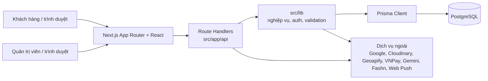
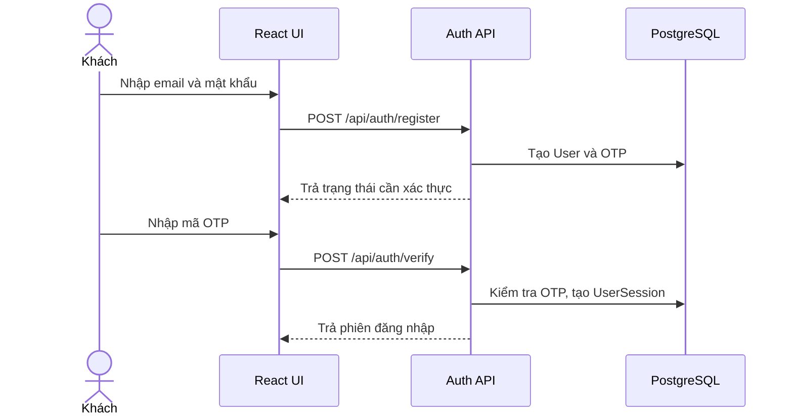
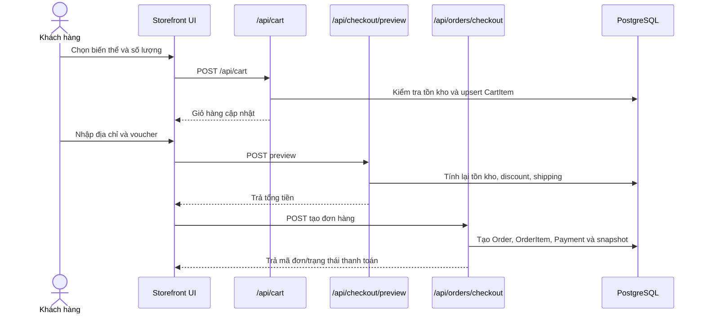
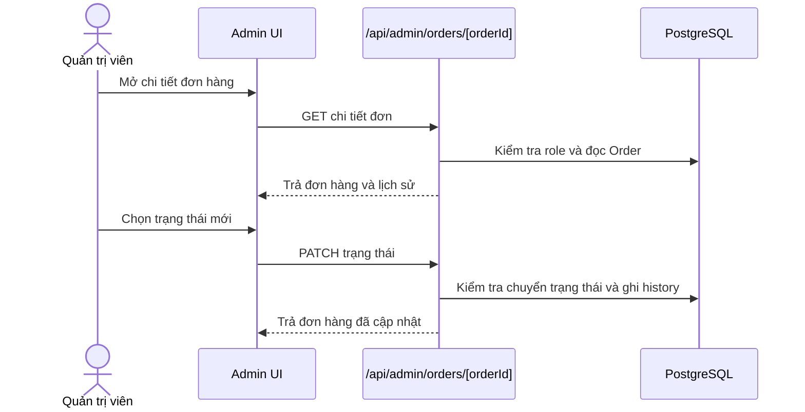
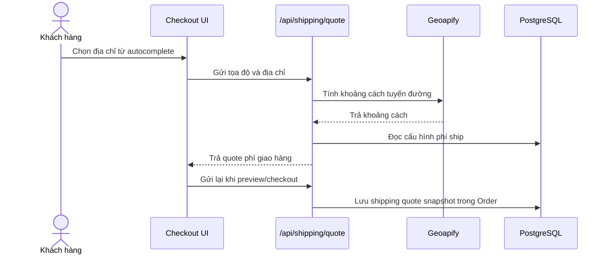

# Tài liệu đặc tả yêu cầu và thiết kế (SRS/SDD)

## 1. Thông tin tài liệu

| Mục | Nội dung |
|---|---|
| Tên hệ thống | Quỳnh Nhi Store – Website bán quần áo và quản trị cửa hàng |
| Kiến trúc | Next.js App Router, TypeScript, Prisma, PostgreSQL |
| API | Next.js Route Handler trong `src/app/api` |
| Tài liệu API nguồn | `docs/swagger.yaml`, `src/lib/swagger.ts` |
| Thiết kế dữ liệu nguồn | `prisma/schema.prisma`, `docs/erd.md` |
| Phiên bản rà soát | 27/11/2026 |

> Tài liệu này được lập bằng cách đối chiếu mã nguồn hiện tại. Khi mã nguồn thay đổi, yêu cầu, sơ đồ và danh sách API phải được rà soát lại.

## 2. Phạm vi hệ thống

- **Khách hàng:** xem sản phẩm, tìm kiếm, lọc, xem chi tiết, yêu thích, giỏ hàng, checkout, thanh toán, theo dõi đơn hàng, đánh giá, voucher, membership, thông báo và trợ lý chat.
- **Quản trị:** quản lý sản phẩm, danh mục, đơn hàng, người dùng, nội dung trang chủ, chính sách, voucher/discount, giao hàng, thanh toán, đánh giá, thông báo và dashboard tài chính.
- **Chức năng mở rộng có mã nguồn:** nhập sản phẩm bằng file, hóa đơn, virtual try-on, gợi ý sản phẩm và Web Push.

## 3. Tác nhân và phân quyền

| Tác nhân | Quyền chính |
|---|---|
| Khách chưa đăng nhập | Xem trang chủ, danh mục, sản phẩm công khai, chính sách, voucher công khai. |
| CUSTOMER | Quản lý tài khoản, địa chỉ, yêu thích, giỏ hàng, checkout, đơn hàng, thanh toán, voucher, membership, đánh giá và thông báo cá nhân. |
| ADMIN | Quản lý sản phẩm, đơn hàng, nội dung, người dùng, cấu hình, vận chuyển, đánh giá và thông báo. |
| SUPER_ADMIN | Quyền quản trị cao hơn theo kiểm tra role trong mã nguồn. |
| Cron/Worker | Xử lý thông báo quản trị, coupon sinh nhật và hết hạn đơn chưa thanh toán. |

## 4. SRS – Đặc tả yêu cầu

### 4.1. Yêu cầu chức năng

#### FR-01. Xác thực và tài khoản

- Đăng ký bằng email, mật khẩu và OTP; đăng nhập bằng email/mật khẩu hoặc Google OAuth.
- Đăng xuất, làm mới phiên, quên mật khẩu và đặt lại mật khẩu bằng OTP.
- Xem/cập nhật hồ sơ, đổi mật khẩu và quản lý địa chỉ giao hàng.
- Role gồm `SUPER_ADMIN`, `ADMIN`, `CUSTOMER`; trạng thái gồm `ACTIVE`, `INACTIVE`, `BLOCKED`.

#### FR-02. Danh mục và sản phẩm

- Xem danh sách sản phẩm công khai, chi tiết, sản phẩm liên quan và gợi ý tìm kiếm.
- Tìm kiếm, lọc, phân trang và sắp xếp sản phẩm.
- Sản phẩm hỗ trợ ảnh, thương hiệu, danh mục, nhóm biến thể, size/màu, SKU, tồn kho và trạng thái.
- Quản trị viên thêm, sửa, xóa, đổi trạng thái, xem trước, upload ảnh và nhập sản phẩm bằng file.
- Hỗ trợ product draft để tạo, áp dụng hoặc loại bỏ bản nháp.

#### FR-03. Giỏ hàng và yêu thích

- Khách hàng đã đăng nhập xem giỏ hàng của mình.
- Thêm sản phẩm/biến thể, cập nhật số lượng và xóa sản phẩm.
- Số lượng không được vượt quá tồn kho khả dụng sau khi trừ số lượng đã giữ chỗ.
- Thêm/xóa sản phẩm yêu thích; quản trị viên có chức năng kiểm tra và đồng bộ số lượt yêu thích.

#### FR-04. Checkout, đơn hàng và thanh toán

- Hiển thị preview checkout gồm sản phẩm, tồn kho, mã giảm giá và phí giao hàng.
- Tạo checkout intent cho giỏ hàng hoặc mua ngay.
- Server tính lại tổng tiền, phí ship và discount trước khi tạo đơn.
- Tạo đơn hàng online, lưu snapshot sản phẩm và địa chỉ tại thời điểm đặt.
- Khách xem danh sách, chi tiết, hủy đơn theo điều kiện và hóa đơn.
- Hỗ trợ COD và luồng VNPay qua create, return và IPN.
- Quản trị xem, cập nhật trạng thái, xác nhận thanh toán và phát hành/xem trước hóa đơn.

#### FR-05. Giao hàng và khuyến mãi

- Tìm kiếm địa chỉ qua Geoapify autocomplete và dữ liệu hành chính.
- Tính phí giao hàng qua server route `/api/shipping/quote`.
- Lưu khoảng cách và phí giao hàng vào snapshot đơn hàng.
- Quản lý coupon, discount, membership, benefit và chương trình khuyến mãi phí ship.

#### FR-06. Nội dung, đánh giá và tương tác

- Hiển thị banner trang chủ, chính sách và rich text.
- Quản trị viên tạo, sửa, xóa, sắp xếp banner/chính sách.
- Khách đã mua sản phẩm có thể tạo đánh giá và ảnh đánh giá.
- Quản trị viên xem, duyệt, ẩn hoặc xử lý đánh giá.
- Hỗ trợ sản phẩm đã xem, sản phẩm đã mua, gợi ý, chat assistant và virtual try-on.

#### FR-07. Thông báo và dashboard

- Khách xem và đánh dấu đã đọc thông báo cá nhân.
- Quản trị xem thông báo đơn hàng/thanh toán, đếm chưa đọc và đánh dấu đã đọc.
- Quản trị đăng ký Web Push, gửi thông báo thử và quản lý subscription.
- Dashboard hiển thị dữ liệu doanh thu, chi phí, lợi nhuận và sản phẩm bán chạy.
- Quản lý kỳ tài chính tháng, chi phí tháng, chi tiết ngày, đơn offline và dữ liệu sản phẩm bán ra.

### 4.2. Yêu cầu phi chức năng

| Mã | Yêu cầu |
|---|---|
| NFR-01 | Kiểm tra dữ liệu đầu vào trước khi ghi database. |
| NFR-02 | API riêng tư phải xác thực phiên và kiểm tra role/quyền sở hữu dữ liệu. |
| NFR-03 | Checkout tính lại giá, tồn kho, voucher và phí ship ở server. |
| NFR-04 | Mật khẩu, OTP, token và secret dịch vụ ngoài lấy từ biến môi trường hoặc cơ chế lưu an toàn. |
| NFR-05 | File/ảnh phải kiểm tra loại file và dung lượng trước khi lưu. |
| NFR-06 | Giao diện hoạt động trên desktop/mobile và có trạng thái loading/error phù hợp. |
| NFR-07 | Tồn kho, đơn hàng, thanh toán và hóa đơn phải có kiểm tra trạng thái/transaction phù hợp. |
| NFR-08 | API trả mã HTTP phù hợp cho lỗi dữ liệu, xác thực, quyền, không tìm thấy và rate limit. |
| NFR-09 | Mã nguồn được kiểm tra bằng TypeScript, ESLint và test trong `package.json`. |
| NFR-10 | Tài liệu phải được đối chiếu với route thật, Prisma schema, Swagger và mã giao diện. |

## 5. SDD – Thiết kế hệ thống

### 5.1. Kiến trúc tổng thể



### 5.2. Module chính

| Module | Vị trí mã nguồn | Trách nhiệm |
|---|---|---|
| Storefront | `src/components/Storefront`, `src/app/products`, `src/app/checkout`, `src/app/account` | Bán hàng, chi tiết, giỏ hàng, checkout, tài khoản. |
| Admin | `src/components/Admin`, `src/app/admin` | Sản phẩm, đơn hàng, nội dung, người dùng, cấu hình, dashboard. |
| API | `src/app/api` | Route Handler cho xác thực, sản phẩm, đơn hàng, thanh toán và báo cáo. |
| Nghiệp vụ | `src/lib` | Auth, order, shipping, discount, review, recommendation, notification, chat. |
| Dữ liệu | `prisma/schema.prisma`, `src/lib/db.ts` | Prisma schema, client và PostgreSQL. |

### 5.3. Thiết kế cơ sở dữ liệu

Các nhóm model thực tế trong `prisma/schema.prisma`:

- **Identity:** `User`, `UserSession`, `Otp`, `PasswordResetToken`, `UserAddress`, `AuditLog`.
- **Catalog:** `Category`, `Brand`, `Product`, `ProductImage`, `VariantGroup`, `VariantOption`, `ProductVariant`, `ProductVariantImage`, `ProductDraft`, `ProductImportJob`.
- **Cart/Wishlist:** `Cart`, `CartItem`, `Wishlist`, `WishlistItem`.
- **Order/Payment:** `Order`, `OrderItem`, `OrderStatusHistory`, `Payment`, `PaymentLog`, `OrderInvoice`, `OrderInvoiceItem`, `InvoiceSequence`.
- **Shipping:** `Warehouse`, `WarehouseInventory`, `Shipping`, `ShippingConfiguration`, `ShippingPromotion`, `InventoryTransaction`.
- **Promotion/Membership:** `Coupon`, `CouponProduct`, `CouponCategory`, `CouponMembership`, `Membership` và các bảng benefit/redemption.
- **Content/Interaction:** `HomepageBanner`, `HomepageSection`, `HomepageFeaturedProduct`, `StorePolicy`, `Review`, `ReviewImage`, `RecentlyViewedProduct`, `ProductViewEvent`.
- **Notification/Finance:** `Notification`, `AdminNotification`, `NotificationOutbox`, `PushSubscription`, `MonthlyFinance`, `DailyFinance`, `MonthlyExpense`, `DailySoldProduct`.

Quan hệ chi tiết, khóa chính và khóa ngoại xem tại [`docs/erd.md`](docs/erd.md), được đồng bộ từ [`prisma/schema.prisma`](prisma/schema.prisma).

### 5.4. Sơ đồ API theo mã nguồn

```mermaid
flowchart TD
    Client[React storefront/admin]
    Auth[/api/auth/*\nregister login google verify refresh logout]
    Catalog[/api/products/*, /api/product/*, /api/category/*]
    Cart[/api/cart/*]
    Checkout[/api/checkout/*, /api/orders/checkout]
    Orders[/api/me/orders/*, /api/order/*, /api/admin/orders/*]
    Admin[/api/admin/*]
    Support[/api/shipping/*, /api/locations/*, /api/discounts/*]
    Payment[/api/payments/vnpay/*]
    DB[(Prisma/PostgreSQL)]
    Client --> Auth
    Client --> Catalog
    Client --> Cart
    Client --> Checkout
    Client --> Orders
    Client --> Admin
    Client --> Support
    Client --> Payment
    Auth --> DB
    Catalog --> DB
    Cart --> DB
    Checkout --> DB
    Orders --> DB
    Admin --> DB
    Support --> DB
    Payment --> DB
```

Các endpoint tiêu biểu đã đối chiếu với route thật:

| Nhóm | Endpoint và phương thức |
|---|---|
| Auth | `POST /api/auth/register`, `POST /api/auth/login`, `POST /api/auth/google`, `POST /api/auth/verify`, `POST /api/auth/forgot-password`, `POST /api/auth/reset-password`, `POST /api/auth/refresh`, `POST /api/auth/logout` |
| Sản phẩm | `GET /api/products`, `GET /api/products/[productId]`, `GET /api/products/[productId]/related`, `GET /api/products/search-suggestions`, `GET/POST/PATCH/DELETE /api/product...` |
| Danh mục | `GET/POST /api/category`, `GET/PUT/DELETE /api/category/[id]` |
| Giỏ hàng | `GET/POST /api/cart`, `PATCH/DELETE /api/cart/[itemId]` |
| Checkout | `POST/GET /api/checkout/cart-intent`, `POST/GET /api/checkout/buy-now-intent`, `POST /api/checkout/preview`, `POST /api/orders/checkout` |
| Đơn hàng | `GET/PATCH /api/order/[orderId]`, `POST /api/order/[orderId]/cancel`, `GET /api/me/orders`, `GET/PATCH /api/admin/orders/[orderId]` |
| Thanh toán | `POST /api/payments/vnpay/create`, `GET /api/payments/vnpay/return`, `GET /api/payments/vnpay/ipn` |
| Giao hàng | `POST /api/shipping/quote`, `POST /api/admin/shipping/preview`, `GET/PUT /api/admin/shipping/configuration` |
| Quản trị | `GET /api/admin/products`, `GET /api/admin/products/[id]`, `GET/POST /api/product-imports`, `POST /api/product-drafts`, `POST /api/product-drafts/[id]/apply` |
| Nội dung | `GET/POST /api/admin/content/banners`, `PATCH/DELETE /api/admin/content/banners/[id]`, `GET/POST /api/admin/content/policies` |
| Báo cáo | `GET /api/summary/current-year`, `GET /api/summary/yearly-revenue`, `GET /api/summary/yearly-expense`, `GET /api/summary/monthly-product-profit`, `GET /api/summary/top-products` |

Danh sách đầy đủ và schema request/response nằm trong [`docs/swagger.yaml`](docs/swagger.yaml). Nếu Swagger và route thật không khớp, `src/app/api` là nguồn cần kiểm tra trước.

### 5.5. Các luồng xử lý chính

#### Luồng A – Đăng ký và xác thực



#### Luồng B – Giỏ hàng và checkout



#### Luồng C – Quản trị cập nhật đơn hàng



#### Luồng D – Tính phí giao hàng



## 6. Kiểm tra tính đúng trước khi nộp

1. Đối chiếu endpoint trong sơ đồ với file `route.ts` tương ứng trong `src/app/api`.
2. Đối chiếu tên bảng, enum, khóa chính và khóa ngoại với `prisma/schema.prisma`.
3. Đối chiếu request/response với `docs/swagger.yaml` và validation trong route.
4. Kiểm tra các luồng checkout, payment, shipping và inventory với mã trong `src/lib`.
5. Chạy các lệnh kiểm tra của dự án:

```bash
npm run type-check
npm run lint
npm test
```

Không dùng sơ đồ mẫu rồi thay tên. Nếu chức năng hoặc endpoint không tồn tại trong mã nguồn, không đưa vào sơ đồ như một chức năng đã hoàn thiện.

